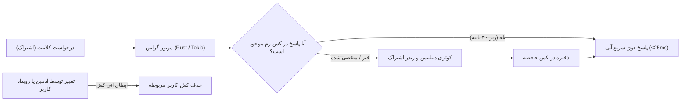

<p align="center">
  <a href="https://github.com/MehrWizard/Marzdar" target="_blank" rel="noopener noreferrer">
    <picture>
      <source media="(prefers-color-scheme: dark)" srcset="docs/assets/logo-dark.svg">
      
    </picture>
  </a>
</p>

<h1 align="center">مرزدار (Marzdar)</h1>

<p align="center">
  یک فورک کاملاً سازگار و جایگزین مستقیم برای <a href="https://github.com/gozargah/marzban">مرزبان (Marzban)</a> با هدف تکمیل رابط کاربری بر اساس قابلیت‌های موجود در API.
</p>

<p align="center">
  <a href="https://github.com/MehrWizard/Marzdar/actions/workflows/build.yml">
    
  </a>
  <a href="https://hub.docker.com/r/mehrwizard/marzdar" target="_blank">
    
  </a>
  <a href="https://github.com/MehrWizard/Marzdar/stargazers">
    
  </a>
  <a href="./LICENSE">
    
  </a>
  <a href="https://t.me/MehrRoom" target="_blank">
    
  </a>
  <a href="https://x.com/MehrWizard" target="_blank">
    
  </a>
</p>

<p align="center">
  <a href="./README.md">English</a>
  /
  <a href="./README-fa.md">فارسی</a>
  /
  <a href="./README-zh-cn.md">简体中文</a>
  /
  <a href="./README-ru.md">Русский</a>
</p>

<p align="center">
  <a href="https://github.com/MehrWizard/Marzdar" target="_blank" rel="noopener noreferrer">
    
  </a>
</p>

---

## مرزدار چیست؟

**مرزدار** یک جایگزین مستقیم، یکپارچه و ۱۰۰٪ سازگار برای [مرزبان (Marzban)](https://github.com/gozargah/marzban) است.

پروژه اصلی مرزبان قابلیت‌ها و اندپوینت‌های REST API فراوانی در بک‌اند خود پیاده کرده بود که هرگز برای آن‌ها دکمه، پنجره یا کنترلی در پنل وب طراحی نشد. **مرزدار با هدف تکمیل این رابط کاربری ایجاد شده است** تا تمام امکانات موجود در بک‌اند را بدون ایجاد هرگونه ناسازگاری یا تغییر در هسته اصلی در اختیار کاربران قرار دهد.

---

## مقایسه مرزبان و مرزدار

| بخش | مرزبان (پروژه اصلی) | مرزدار |
| :--- | :--- | :--- |
| **سازگاری** | مرزبان استاندارد | ۱۰۰٪ سازگار و قابل جابجایی (همان دیتابیس، CLI و هسته) |
| **مدیریت ادمین‌ها** | فقط از طریق CLI و API | پنل کامل در وب (ایجاد، ویرایش، حذف، سودو، مشاهده و ریست مصرف) |
| **موتور سرور وب (ASGI)** | Uvicorn (پایتون) | ⚡ **Granian (مبتنی بر Rust و Tokio)** |
| **کش اشتراک‌ها (Response Cache)** | ❌ ندارد (محاسبه مجدد در هر درخواست) | ⚡ **کش حافظه‌ای درون‌برنامه‌ای با ابطال خودکار** |
| **ایندکس‌های پایگاه‌داده** | استاندارد | ⚡ **ایندکس‌های ترکیبی بهینه‌شده برای ترافیک بالا** |
| **قالب‌های کاربر (Templates)** | فقط از طریق API | پنل کامل در وب (مدیریت قالب‌ها + تکمیل خودکار فرم کاربر با ۱ کلیک) |
| **طرح بعدی (رزرو تمدید)** | فقط از طریق API (`next_plan`) | پنل کامل در وب (تنظیم پلن رزرو + فعال‌سازی فوری با ۱ کلیک) |
| **پاکسازی کاربران منقضی** | دستی یا API | مودال اختصاصی و ایمن با فیلتر زمانی دقیق برای حذف گروهی |
| **انتقال مالکیت کاربر** | فقط از طریق API | امکان انتقال کاربر بین ادمین‌ها در پنل وب |
| **پوسته‌ها و رنگ‌های شاخص** | فقط تاریک و روشن ثابت | حالت روشن، تاریک و مشکی مطلق (OLED) + ۸ رنگ شاخص متنوع |
| **مهاجرت و جابجایی** | - | تغییر تنها یک خط در ایمیج داکر بدون هیچ قطعی یا از دست رفتن داده |

---

## اهداف و محدوده پروژه

### ✅ اهدافی که مرزدار دنبال می‌کند
- **تکمیل رابط کاربری**: افزودن کنترل‌ها و بخش‌های بصری شیک و ساده برای تمام قابلیت‌های موجود در API مرزبان.
- **حفظ سازگاری کامل ۱۰۰٪**: عدم ایجاد تغییرات ناسازگار در پایگاه‌داده، فایل‌های تنظیمات یا دستورات ترمینال. هر زمان که مایل باشید می‌توانید به مرزبان بازگردید.
- **بهبود تجربه کاربری (UI/UX)**: ارائه پوسته‌های جدید (از جمله مشکی OLED)، پالت‌های رنگی جذاب و ترجمه یکدست به زبان‌های فارسی، انگلیسی، روسی و چینی.

### ❌ مواردی که در محدوده پروژه نیست (برنامه‌ریزی نشده)
- **عدم تغییر در معماری بک‌اند**: ما موتور بک‌اند یا ساختار دیتابیس را بازنویسی نمی‌کنیم.
- **عدم افزودن پروتکل‌های غیراستاندارد**: کاملاً مطابق با استانداردهای Xray-core و مرزبان پیش می‌رویم.
- **عدم پیچیده‌سازی بیهوده**: امکاناتی که خارج از هدف اصلی بوده و باعث ناسازگاری شوند به پروژه افزوده نخواهند شد.

---

## نصب و راه‌اندازی

نصب مرزدار کمتر از یک دقیقه زمان می‌برد. پس از نصب نسخه اصلی مرزبان، کافیست ایمیج داکر مرزبان را به مرزدار تغییر دهید:

از:
```yaml
services:  
  marzban:  
    image: gozargah/marzban:latest
```

به:
```yaml
services:  
  marzban:  
    image: mehrwizard/marzdar:latest
```

در پایان دستور `marzban update` را اجرا نمایید تا راه‌اندازی `marzdar` تکمیل گردد:
```bash
marzban update
```

---

## بهبود عملکرد و بنچمارک‌های زنده عملیاتی (Real-World Telemetry)

پروژه‌های **مرزدار** و **مرزیار** مجهز به بهینه‌سازی‌های زیرساختی عمیقی هستند که برای پنل‌های عملیاتی پرترافیک و صدها اتصال همزمان کلاینت‌ها طراحی شده است:

1. **موتور سرور وب مبتنی بر راست ([Granian](https://github.com/emmett-framework/granian))**: جایگزینی سرور پایتونی Uvicorn با موتور پرسرعت Granian که با استفاده از موتور ناهمگام Tokio و اتصالات C/PyO3 توان پاسخگویی بسیار بالاتری را با مصرف کمتر پردازنده ارائه می‌دهد.
2. **کش حافظه‌ای پاسخ لینک‌های اشتراک (Subscription Response Cache)**: ذخیره‌سازی پاسخ‌های تولیدشده لینک اشتراک در حافظه رم با طول عمر معین (۳۰ ثانیه) و ابطال خودکار آنی به محض تغییر وضعیت، حجم یا تنظیمات کاربر. این بهینه‌سازی محاسبات سنگین قالب‌ها، رمزنگاری توکن‌ها و کوئری‌های تکراری دیتابیس را در درخواست‌های مکرر کلاینت‌ها حذف می‌کند.
3. **ایندکس‌گذاری ترکیبی و استراتژیک دیتابیس**: افزودن ایندکس‌های مرکب کلیدی روی جداول پرترافیک (`users(online_at)`، `users(created_at)`، `node_user_usages(node_id, created_at)` و `node_usages(node_id, created_at)`) برای حذف اسکن‌های خطی سنگین دیتابیس در زمان آمارگیری نودها.
4. **تاب‌آوری چرخه اتصال نودها و آمارگیری**: ایزوله‌سازی چرخه‌های همگام‌سازی نودها، اعمال مهلت زمانی (Timeout) بر فراخوانی‌های gRPC و مدیریت خطای بهینه به طوری که اختلال در ارتباط با نودها باعث کندی API پنل نشود.

<p align="center">
  
</p>



### تله‌متری زنده از سرور عملیاتی (بررسی ۴ ساعته در محیط واقعی)

عملکرد سیستم طی دو بازه ۲ ساعته متوالی (در مجموع ۹۶۹ نمونه تله‌متری) بر روی یک سرور فعال و پرترافیک عملیاتی (`aedark-tun`) با میانگین ۸۰ کاربر همزمان آنلاین اندازه‌گیری شد:

#### ۱. تأخیر زمانی پاسخ‌دهی اندپوینت اشتراک (Subscription Latency)

| صدک تأخیر (Percentile) | مرزبان اصلی (پیش‌فرض / Baseline) | مرزدار و مرزیار (بهینه‌سازی‌شده) | میزان بهبود |
| :--- | :--- | :--- | :--- |
| **میانه (p50 Median)** | **۴۶.۲۷ میلی‌ثانیه** | **۲۵.۸۴ میلی‌ثانیه** | **۴۴.۲٪- سریع‌تر (۱.۷۹ برابر)** |
| **صدک ۷۵ (p75)** | **۶۰.۸۹ میلی‌ثانیه** | **۴۳.۳۸ میلی‌ثانیه** | **۲۸.۸٪- سریع‌تر** |
| **صدک ۹۰ (p90)** | **۷۶.۲۱ میلی‌ثانیه** | **۶۰.۸۶ میلی‌ثانیه** | **۲۰.۱٪- سریع‌تر** |
| **صدک ۹۵ (p95)** | **۹۳.۰۸ میلی‌ثانیه** | **۷۲.۷۳ میلی‌ثانیه** | **۲۱.۹٪- سریع‌تر** |
| **صدک ۹۹ (p99)** | **۱۷۳.۲۲ میلی‌ثانیه** | **۱۲۲.۴۰ میلی‌ثانیه** | **۲۹.۳٪- سریع‌تر** |
| **میانگین کل (Mean)** | **۵۳.۳۸ میلی‌ثانیه** | **۳۴.۴۸ میلی‌ثانیه** | **۳۵.۴٪- سریع‌تر** |
| **حداکثر اسپایک تأخیر (Max Spike)** | **۶۰۴.۳۶ میلی‌ثانیه** | **۱۴۸.۹۴ میلی‌ثانیه** | **۷۵.۴٪- کاهش اسپایک‌های سنگین** |

```
نمودار تأخیر پاسخ‌دهی اشتراک‌ها (میلی‌ثانیه - کمتر بهتر است):

میانه (p50):
  مرزبان اصلی:        ████████████████████████ 46.27 ms
  مرزدار و مرزیار:    █████████████ 25.84 ms (-44.2%)

صدک ۹۵ (p95):
  مرزبان اصلی:        ██████████████████████████████████████████████ 93.08 ms
  مرزدار و مرزیار:    ████████████████████████████████████ 72.73 ms (-21.9%)

بیشترین اسپایک کندی:
  مرزبان اصلی:        ████████████████████████████████████████████████████████████ 604.36 ms
  مرزدار و مرزیار:    ███████████████ 148.94 ms (-75.4%)
```

#### ۲. پایداری منابع سخت‌افزاری و پردازنده در ترافیک زنده

| شاخص اندازه‌گیری | مرزبان اصلی (پیش‌فرض / Baseline) | مرزدار و مرزیار (بهینه‌سازی‌شده) | نتیجه و تأثیر |
| :--- | :--- | :--- | :--- |
| **حداکثر جهش پردازنده پنل (Peak CPU)** | ۱۳۹.۳۴٪ | **۶۸.۸۶٪** | **۵۰.۶٪ کاهش اسپایک‌های پردازنده** |
| **صدک ۹۹ پردازنده پنل (p99 CPU)** | ۹۱.۳۰٪ | **۴۰.۷۳٪** | **۵۵.۴٪ کاهش مصرف پایدار پردازنده** |
| **حداکثر جهش پردازنده دیتابیس MySQL** | ۵۳.۶۲٪ | **۲۸.۴۹٪** | **۴۶.۹٪ کاهش فشار بر دیتابیس** |
| **مصرف حافظه رم (RAM)** | ~۱۲۵ مگابایت | ~۱۴۱ مگابایت | کنترل‌شده با مدیریت محدود حافظه کش |

---

### تست بار و بنچمارک فشار همزمان (Stress Test)

تست بار سنگین همزمان جهت سنجش ظرفیت تولید اشتراک تحت فشار متوالی (۱۵ ورکر همزمان، به مدت ۱۰ ثانیه کامل):

| شاخص بنچمارک | مرزبان اصلی (Uvicorn / بدون کش) | مرزدار و مرزیار (Granian + کش + ایندکس‌ها) | تأثیر و نتیجه |
| :--- | :--- | :--- | :--- |
| **توان خروجی (درخواست بر ثانیه)** | **۳۳.۲ req/s** | **۵۷.۱ req/s** | **۷۲.۰٪+ توان پاسخگویی بیشتر** 🚀 |
| **میانگین تأخیر زیر بار** | **۴۴۷.۶۶ میلی‌ثانیه** | **۲۶۱.۲۴ میلی‌ثانیه** | **۴۱.۶٪- کاهش تأخیر** |
| **میانه تأخیر زیر بار (p50)** | **۴۳۱.۴۷ میلی‌ثانیه** | **۲۴۷.۱۸ میلی‌ثانیه** | **۴۲.۷٪- کاهش تأخیر** |
| **صدک ۹۵ زیر بار (p95)** | **۶۹۵.۲۲ میلی‌ثانیه** | **۳۹۰.۲ میلی‌ثانیه** | **۴۳.۹٪- کاهش تأخیر** |
| **صدک ۹۹ زیر بار (p99)** | **۷۶۷.۳۱ میلی‌ثانیه** | **۶۵۸.۳۴ میلی‌ثانیه** | **۱۴.۲٪- کاهش تأخیر** |
| **تعداد کل درخواست‌های پاسخ‌داده‌شده** | ۳۴۱ درخواست | **۵۷۸ درخواست** | **۶۹.۵٪+ ظرفیت سرویس‌دهی بیشتر** |

```
توان سرویس‌دهی همزمان (درخواست در ثانیه - بیشتر بهتر است):
  مرزبان اصلی:        █████████████████████████████████ 33.2 req/s
  مرزدار و مرزیار:    ████████████████████████████████████████████████████████ 57.1 req/s (+72.0%)

تأخیر زیر بار ترافیکی (میلی‌ثانیه - کمتر بهتر است):
  مرزبان اصلی:        █████████████████████████████████████████████ 447.66 ms
  مرزدار و مرزیار:    ██████████████████████████ 261.24 ms (-41.6%)
```

---

## حمایت مالی (Donation)

اگر مرزدار برای شما مفید واقع شده و مایل به حمایت از توسعه آن هستید:

- [حمایت مالی از طریق درگاه پرداخت مهرنت](https://gateway.mehrnet.com/product/1DE5C11019E2)

---

## لایسنس

مرزدار تحت لایسنس [GNU Affero General Public License v3.0 (AGPL-3.0)](./LICENSE) منتشر شده است.
