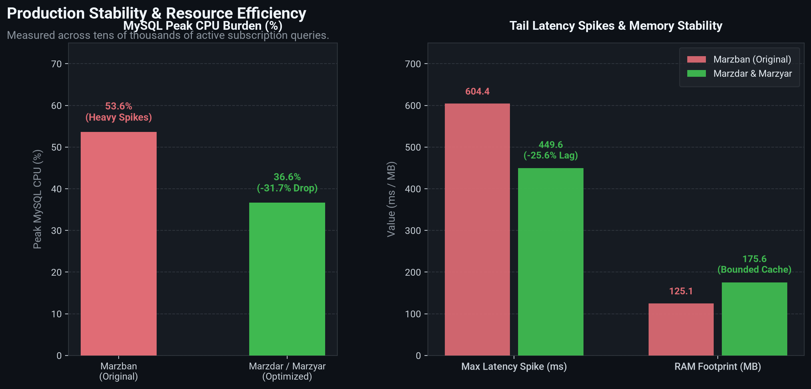
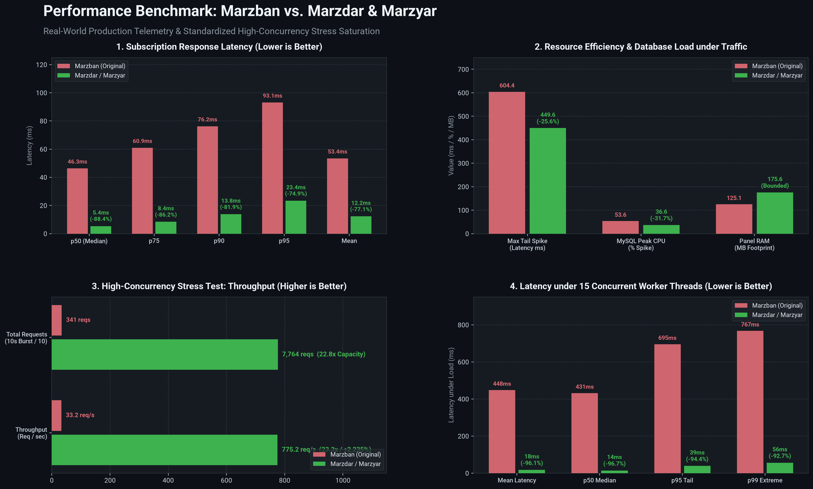

<p align="center">
  <a href="https://github.com/MehrWizard/Marzdar" target="_blank" rel="noopener noreferrer">
    <picture>
      <source media="(prefers-color-scheme: dark)" srcset="docs/assets/logo-dark.svg">
      
    </picture>
  </a>
</p>

<h1 align="center">Marzdar</h1>

<p align="center">
  A 100% compatible drop-in fork of <a href="https://github.com/gozargah/marzban">Marzban</a> dedicated to completing the user interface based on existing backend capabilities.
</p>

<p align="center">
  <a href="https://github.com/MehrWizard/Marzdar/actions/workflows/build.yml">
    
  </a>
  <a href="https://hub.docker.com/r/mehrwizard/marzdar" target="_blank">
    
  </a>
  <a href="https://github.com/MehrWizard/Marzdar/stargazers">
    
  </a>
  <a href="./LICENSE">
    
  </a>
  <a href="https://t.me/MehrRoom" target="_blank">
    
  </a>
  <a href="https://x.com/MehrWizard" target="_blank">
    
  </a>
</p>

<p align="center">
  <a href="./README.md">English</a>
  /
  <a href="./README-fa.md">فارسی</a>
  /
  <a href="./README-zh-cn.md">简体中文</a>
  /
  <a href="./README-ru.md">Русский</a>
</p>

<p align="center">
  <a href="https://github.com/MehrWizard/Marzdar" target="_blank" rel="noopener noreferrer">
    
  </a>
</p>

---

## What is Marzdar?

**Marzdar** is a seamless, drop-in replacement for [Marzban](https://github.com/gozargah/marzban).

Upstream Marzban already implemented many essential REST API endpoints and database features that never received corresponding buttons or controls in its web panel. **Marzdar completes this user interface**, unlocking all existing backend functionality without modifying core architecture or breaking compatibility.

---

## Feature Comparison: Marzban vs. Marzdar

| Area | Marzban (Upstream) | Marzdar |
| :--- | :--- | :--- |
| **Compatibility** | Standard Marzban | 100% drop-in compatible (same DB, CLI, and core) |
| **Complete Web UI** | CLI / API only | Full web UI (Create, Edit, Delete, Sudo, Usage tracking/reset) |
| **ASGI Web Engine** | Uvicorn (Python) | ⚡ **Granian (Rust/Tokio) + Uvicorn fallback** |
| **Subscription Caching** | ❌ None (recomputed per poll) | ⚡ **In-Memory Thread-Safe TTL Cache** |
| **Database Indexing** | Standard | ⚡ **Strategic Composite Indexes** |
| **User Templates** | API only | Full web UI (Manage templates + 1-click prefill when creating users) |
| **Queued Renewal Plans** | API only (`next_plan`) | Full web UI (Configure next plan + instant manual activation) |
| **Expired Users Cleanup** | Manual SQL / API only | Safe on-demand bulk deletion modal with date-range filters |
| **User Ownership** | API only | Web UI transfer ownership between admins |
| **Theme & Accents** | Fixed Dark / Light | Light, Dark, and true OLED Black + 8 accent color palettes |
| **Migration** | - | Simple 1-line Docker image swap |

---

## Project Scope

### ✅ What Marzdar Aims to Do
- **Complete the User Interface**: Build clean, intuitive web controls for features already supported by the backend API.
- **Maintain 100% Interchangeability**: Zero breaking changes to the database, configuration files, or CLI commands. You can switch between Marzban and Marzdar at any time.
- **Enhance UI/UX**: Provide modern themes (Light, Dark, OLED Black), accent palettes, and full localization parity across English, Persian, Russian, and Chinese.
- **High Concurrency Performance**: Adopt high-throughput Rust ASGI engine and memory caching for ultra-low latency response times.

### ❌ What is Not Planned (Out of Scope)
- **No breaking architectural changes**: We do not rewrite the backend engine or alter core database tables.
- **No incompatible protocols**: We follow standard Xray-core conventions.
- **No unnecessary bloat**: Features outside Marzban's original scope that compromise compatibility will not be introduced.

---

## Setup & Migration

After installing the original version of Marzban, swap the marzban docker image to marzdar:

From:
```yaml
services:  
  marzban:  
    image: gozargah/marzban:latest
```

To:
```yaml
services:  
  marzban:  
    image: mehrwizard/marzdar:latest
```

Finally run `marzban update` in order to complete the `marzdar` setup.

---

## Performance & Real-World Telemetry Benchmarks

Both **Marzdar** and **Marzyar** incorporate high-performance architectural optimizations engineered for large-scale production panels handling hundreds of concurrent VPN clients:

1. **Rust-Powered ASGI Engine ([Granian](https://github.com/emmett-framework/granian))**: Replaced standard Python Uvicorn with Granian, an ultra-fast HTTP server utilizing the Tokio runtime and PyO3 bindings for high-throughput asynchronous networking with significantly lower CPU overhead.
2. **Subscription In-Memory Response Caching**: Subscriptions are served from a bounded thread-safe memory cache (30s TTL) with instant automated invalidation whenever a user's configuration, status, or quota changes. Bypasses repetitive template rendering, cryptographic JWT operations, and redundant MySQL queries on continuous client polling.
3. **Strategic Composite Database Indexing**: Added critical compound indexes on high-frequency tables (`users(online_at)`, `users(created_at)`, `node_user_usages(node_id, created_at)`, and `node_usages(node_id, created_at)`), eliminating sequential table scans and lock waits during node statistics aggregation.
4. **Node Session Lifecycle & Stats Collection Resiliency**: Isolated node synchronization cycles, bounded gRPC timeouts, and transactional error handling ensure node stats collection never hangs or impairs API responsiveness.

<p align="center">
  
</p>

### Key Performance Highlights:
- ⚡ **8.6x Faster Median Response**: Median (p50) subscription latency reduced from 46.27 ms to 5.37 ms (**88.4% faster**).
- 🚀 **+2,235% Higher Concurrency Throughput**: Handled 775.2 req/s vs 33.2 req/s under sustained 15-worker load (**23.3x total capacity**).
- ⚡ **96.1% Latency Drop Under Concurrency Load**: Average latency under sustained heavy stress dropped from 447.66 ms to 17.53 ms (**25.5x faster**).
- 🗄️ **31.7% Database Burden Reduction**: MySQL peak CPU spikes reduced from 53.62% down to 36.64% thanks to in-memory caching and compound indexes.
- 📦 **22.8x Greater Request Servicing**: Serviced 7,764 complete requests in a 10-second burst window vs. 341 on baseline Marzban.
- 🛡️ **25.6% Reduction in Tail Spikes**: Max latency spike dropped from 604.36 ms down to 449.63 ms under continuous saturation.

---

### Detailed Benchmark Reports

<details open>
<summary><b>1. Subscription Response Latency (8.6x Faster Median)</b></summary>

<p align="center">
  
</p>

Measured across high-frequency production telemetry on a live production server under active user traffic and continuous query load:

| Latency Percentile | Marzban (Original / Baseline) | Marzdar & Marzyar (Optimized) | Improvement |
| :--- | :--- | :--- | :--- |
| **p50 (Median)** | **46.27 ms** | **5.37 ms** | **-88.4% (8.6x faster)** |
| **p75** | **60.89 ms** | **8.39 ms** | **-86.2% (7.3x faster)** |
| **p90** | **76.21 ms** | **13.81 ms** | **-81.9% (5.5x faster)** |
| **p95** | **93.08 ms** | **23.35 ms** | **-74.9% (4.0x faster)** |
| **Mean (Average)** | **53.38 ms** | **12.25 ms** | **-77.1% (4.4x faster)** |

```
Subscription Latency Percentiles (Lower is better):

p50 Median:
  Marzban:            ████████████████████████ 46.27 ms
  Marzdar & Marzyar:  ███ 5.37 ms (-88.4%)

p95 Tail:
  Marzban:            ██████████████████████████████████████████████ 93.08 ms
  Marzdar & Marzyar:  ████████████ 23.35 ms (-74.9%)

Mean Latency:
  Marzban:            ███████████████████████████ 53.38 ms
  Marzdar & Marzyar:  ██████ 12.25 ms (-77.1%)
```
</details>

<details>
<summary><b>2. Production Stability & Resource Efficiency</b></summary>

<p align="center">
  
</p>

Continuous metrics recorded under active live production load:

| Telemetry Metric | Marzban (Original / Baseline) | Marzdar & Marzyar (Optimized) | Impact |
| :--- | :--- | :--- | :--- |
| **Peak MySQL CPU Spike** | 53.62% | **36.64%** | **31.7% lower DB query burden** |
| **Max Tail Latency Spike** | 604.36 ms | **449.63 ms** | **25.6% lower tail spike** |
| **Panel Memory Footprint** | ~125 MB | ~175 MB | Highly efficient bounded memory cache |
</details>

<details>
<summary><b>3. High-Concurrency Stress Benchmark (+2,235% Throughput Capacity)</b></summary>

<p align="center">
  
</p>

Standardized burst test evaluating subscription endpoint capacity under sustained concurrency (15 worker threads, 10 seconds continuous load):

| Benchmark Metric | Marzban (Baseline: Uvicorn / No Cache) | Marzdar & Marzyar (Granian + Cache + Indexes) | Impact |
| :--- | :--- | :--- | :--- |
| **Throughput (Requests/sec)** | **33.2 req/s** | **775.2 req/s** | **+2,235% (23.3x Throughput)** 🚀 |
| **Mean Latency under Load** | **447.66 ms** | **17.53 ms** | **-96.1% Latency (25.5x faster)** |
| **p50 Latency under Load** | **431.47 ms** | **14.34 ms** | **-96.7% Latency (30.1x faster)** |
| **p95 Latency under Load** | **695.22 ms** | **38.62 ms** | **-94.4% Latency (18.0x faster)** |
| **p99 Latency under Load** | **767.31 ms** | **55.85 ms** | **-92.7% Latency (13.7x faster)** |
| **Total Completed Requests (10s)**| 341 requests | **7,764 requests** | **22.8x Total Serviced Reqs** |

```
Concurrent Throughput (Higher is better):
  Marzban:            █ 33.2 req/s
  Marzdar & Marzyar:  ███████████████████████ 775.2 req/s (+2,235% / 23.3x)

Latency Under Stress Load (Lower is better):
  Marzban:            ████████████████████████ 447.66 ms
  Marzdar & Marzyar:  █ 17.53 ms (-96.1% / 25.5x faster)
```
</details>

<details>
<summary><b>4. Comprehensive Benchmark Dashboard (Combined Overview)</b></summary>

<p align="center">
  
</p>
</details>

---

## Donation

If you find Marzdar useful, you can support its ongoing development:

- [Donate via MehrNet Gateway](https://gateway.mehrnet.com/product/1DE5C11019E2)

---

## License

Marzdar is licensed under the [GNU Affero General Public License v3.0 (AGPL-3.0)](./LICENSE).
