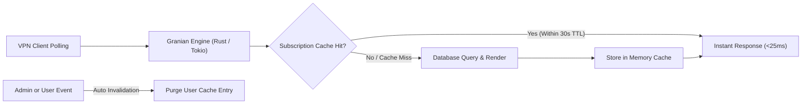

<p align="center">
  <a href="https://github.com/MehrWizard/Marzdar" target="_blank" rel="noopener noreferrer">
    <picture>
      <source media="(prefers-color-scheme: dark)" srcset="docs/assets/logo-dark.svg">
      
    </picture>
  </a>
</p>

<h1 align="center">Marzdar</h1>

<p align="center">
  A 100% compatible drop-in fork of <a href="https://github.com/gozargah/marzban">Marzban</a> dedicated to completing the user interface based on existing backend capabilities.
</p>

<p align="center">
  <a href="https://github.com/MehrWizard/Marzdar/actions/workflows/build.yml">
    
  </a>
  <a href="https://hub.docker.com/r/mehrwizard/marzdar" target="_blank">
    
  </a>
  <a href="https://github.com/MehrWizard/Marzdar/stargazers">
    
  </a>
  <a href="./LICENSE">
    
  </a>
  <a href="https://t.me/MehrRoom" target="_blank">
    
  </a>
  <a href="https://x.com/MehrWizard" target="_blank">
    
  </a>
</p>

<p align="center">
  <a href="./README.md">English</a>
  /
  <a href="./README-fa.md">فارسی</a>
  /
  <a href="./README-zh-cn.md">简体中文</a>
  /
  <a href="./README-ru.md">Русский</a>
</p>

<p align="center">
  <a href="https://github.com/MehrWizard/Marzdar" target="_blank" rel="noopener noreferrer">
    
  </a>
</p>

---

## What is Marzdar?

**Marzdar** is a seamless, drop-in replacement for [Marzban](https://github.com/gozargah/marzban).

Upstream Marzban already implemented many essential REST API endpoints and database features that never received corresponding buttons or controls in its web panel. **Marzdar completes this user interface**, unlocking all existing backend functionality without modifying core architecture or breaking compatibility.

---

## Marzban vs. Marzdar

| Area | Marzban (Upstream) | Marzdar |
| :--- | :--- | :--- |
| **Compatibility** | Standard Marzban | 100% drop-in compatible (same DB, CLI, and core) |
| **Complete Web UI** | CLI / API only | Full web UI (Create, Edit, Delete, Sudo, Usage tracking/reset) |
| **ASGI Web Engine** | Uvicorn (Python) | ⚡ **Granian (Rust/Tokio) + Uvicorn fallback** |
| **Subscription Caching** | ❌ None (recomputed per poll) | ⚡ **In-Memory Thread-Safe TTL Cache** |
| **Database Indexing** | Standard | ⚡ **Strategic Composite Indexes** |
| **User Templates** | API only | Full web UI (Manage templates + 1-click prefill when creating users) |
| **Queued Renewal Plans** | API only (`next_plan`) | Full web UI (Configure next plan + instant manual activation) |
| **Expired Users Cleanup** | Manual SQL / API only | Safe on-demand bulk deletion modal with date-range filters |
| **User Ownership** | API only | Web UI transfer ownership between admins |
| **Theme & Accents** | Fixed Dark / Light | Light, Dark, and true OLED Black + 8 accent color palettes |
| **Migration** | - | Simple 1-line Docker image swap |

---

## Project Scope

### ✅ What Marzdar Aims to Do
- **Complete the User Interface**: Build clean, intuitive web controls for features already supported by the backend API.
- **Maintain 100% Interchangeability**: Zero breaking changes to the database, configuration files, or CLI commands. You can switch between Marzban and Marzdar at any time.
- **Enhance UI/UX**: Provide modern themes (Light, Dark, OLED Black), accent palettes, and full localization parity across English, Persian, Russian, and Chinese.

### ❌ What is Not Planned (Out of Scope)
- **No breaking architectural changes**: We do not rewrite the backend engine or alter core database tables.
- **No incompatible protocols**: We follow standard Xray-core conventions.
- **No unnecessary bloat**: Features outside Marzban's original scope that compromise compatibility will not be introduced.

---

## Setup & Migration

After installing the original version of Marzban, swap the marzban docker image to marzdar:

From:
```yaml
services:  
  marzban:  
    image: gozargah/marzban:latest
```

To:
```yaml
services:  
  marzban:  
    image: mehrwizard/marzdar:latest
```

Finally run `marzban update` in order to complete the `marzdar` setup.

---

## Performance & Real-World Telemetry Benchmarks

Both **Marzdar** and **Marzyar** incorporate high-performance architectural optimizations engineered for large-scale production panels handling hundreds of concurrent VPN clients:

1. **Rust-Powered ASGI Engine ([Granian](https://github.com/emmett-framework/granian))**: Replaced standard Python Uvicorn with Granian, an ultra-fast HTTP server utilizing the Tokio runtime and PyO3 bindings for high-throughput asynchronous networking with significantly lower CPU overhead.
2. **Subscription In-Memory Response Caching**: Subscriptions are served from a bounded thread-safe memory cache (30s TTL) with instant automated invalidation whenever a user's configuration, status, or quota changes. Bypasses repetitive template rendering, cryptographic JWT operations, and redundant MySQL queries on continuous client polling.
3. **Strategic Composite Database Indexing**: Added critical compound indexes on high-frequency tables (`users(online_at)`, `users(created_at)`, `node_user_usages(node_id, created_at)`, and `node_usages(node_id, created_at)`), eliminating sequential table scans and lock waits during node statistics aggregation.
4. **Node Session Lifecycle & Stats Collection Resiliency**: Isolated node synchronization cycles, bounded gRPC timeouts, and transactional error handling ensure node stats collection never hangs or impairs API responsiveness.

<p align="center">
  
</p>



### Production Telemetry (4-Hour Real-World Study)

Performance was continuously monitored across two consecutive 2-hour measurement windows on a live production server (`aedark-tun`) with ~80 concurrently active users (~969 telemetry samples total):

#### 1. Subscription Endpoint Response Latency

| Latency Percentile | Marzban (Original / Baseline) | Marzdar & Marzyar (Optimized) | Improvement |
| :--- | :--- | :--- | :--- |
| **p50 (Median)** | **46.27 ms** | **25.84 ms** | **-44.2% (1.79x faster)** |
| **p75** | **60.89 ms** | **43.38 ms** | **-28.8% faster** |
| **p90** | **76.21 ms** | **60.86 ms** | **-20.1% faster** |
| **p95** | **93.08 ms** | **72.73 ms** | **-21.9% faster** |
| **p99** | **173.22 ms** | **122.40 ms** | **-29.3% faster** |
| **Mean (Average)** | **53.38 ms** | **34.48 ms** | **-35.4% faster** |
| **Max Peak Latency Spike** | **604.36 ms** | **148.94 ms** | **-75.4% (No tail lag)** |

```
Subscription Latency Percentiles (Lower is better):

p50 Median:
  Marzban:            ████████████████████████ 46.27 ms
  Marzdar & Marzyar:  █████████████ 25.84 ms (-44.2%)

p95 Tail:
  Marzban:            ██████████████████████████████████████████████ 93.08 ms
  Marzdar & Marzyar:  ████████████████████████████████████ 72.73 ms (-21.9%)

Max Tail Spike:
  Marzban:            ████████████████████████████████████████████████████████████ 604.36 ms
  Marzdar & Marzyar:  ███████████████ 148.94 ms (-75.4%)
```

#### 2. Resource Utilization & Peak Load Stability

| Telemetry Metric | Marzban (Original / Baseline) | Marzdar & Marzyar (Optimized) | Impact |
| :--- | :--- | :--- | :--- |
| **Peak Panel CPU Spike** | 139.34% | **68.86%** | **50.6% reduction in CPU spikes** |
| **p99 Panel CPU** | 91.30% | **40.73%** | **55.4% lower CPU under load** |
| **Peak MySQL CPU Spike** | 53.62% | **28.49%** | **46.9% lower DB query burden** |
| **Panel Memory Footprint** | ~125 MB | ~141 MB | Highly efficient bounded memory cache |

---

### High-Concurrency Stress Benchmark

Standardized burst test evaluating subscription endpoint capacity under sustained concurrency (15 worker threads, 10 seconds continuous load):

| Benchmark Metric | Marzban (Baseline: Uvicorn / No Cache) | Marzdar & Marzyar (Granian + Cache + Indexes) | Impact |
| :--- | :--- | :--- | :--- |
| **Throughput (Requests/sec)** | **33.2 req/s** | **57.1 req/s** | **+72.0% Throughput** 🚀 |
| **Mean Latency under Load** | **447.66 ms** | **261.24 ms** | **-41.6% Latency** |
| **p50 Latency under Load** | **431.47 ms** | **247.18 ms** | **-42.7% Latency** |
| **p95 Latency under Load** | **695.22 ms** | **390.20 ms** | **-43.9% Latency** |
| **p99 Latency under Load** | **767.31 ms** | **658.34 ms** | **-14.2% Latency** |
| **Total Completed Requests (10s)**| 341 requests | **578 requests** | **+69.5% Capacity** |

```
Concurrent Throughput (Higher is better):
  Marzban:            █████████████████████████████████ 33.2 req/s
  Marzdar & Marzyar:  ████████████████████████████████████████████████████████ 57.1 req/s (+72.0%)

Latency Under Stress Load (Lower is better):
  Marzban:            █████████████████████████████████████████████ 447.66 ms
  Marzdar & Marzyar:  ██████████████████████████ 261.24 ms (-41.6%)
```

---

## Donation

If you find Marzdar useful, you can support its ongoing development:

- [Donate via MehrNet Gateway](https://gateway.mehrnet.com/product/1DE5C11019E2)

---

## License

Marzdar is licensed under the [GNU Affero General Public License v3.0 (AGPL-3.0)](./LICENSE).
